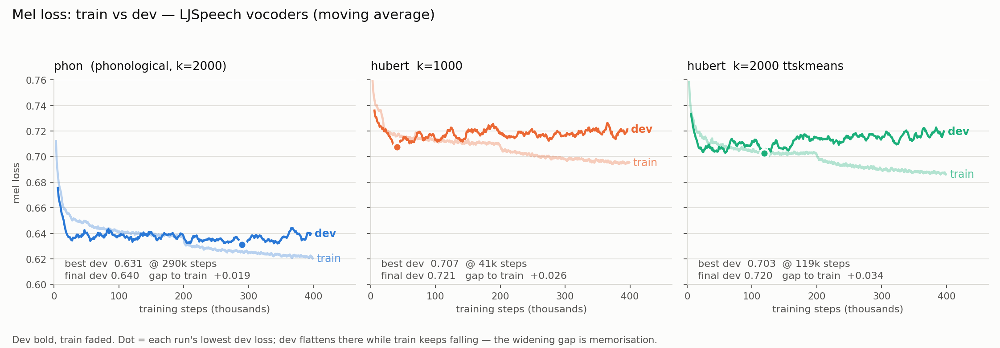

# LJSpeech recipes

Besides the stock mel-spectrogram recipe (`voc1`), this directory holds seven
**discrete-token vocoders**: HiFiGAN generators that synthesise 16 kHz speech
from discrete content tokens instead of a mel-spectrogram. They share one
pipeline, one model architecture and one training schedule, and differ only in
which tokenizer produced the tokens — so differences between them are
attributable to the token stream itself.

The HuBERT and WavLM k-means models come from the VoxtLM recipe
(`espnet/egs2/voxtlm_v1`), so these vocoders can resynthesise that speech LM's
output directly.

## Recipes

| Recipe | Content tokens | Codebook | Pretrained weights |
|---|---|---|---|
| `phon_voc1` | [Sony Phonological-Tokenizer](https://huggingface.co/Sony/Phonological-Tokenizer) (fine-tuned WavLM-large) | 2000 | [phon_voc1](https://huggingface.co/RuiRuihigh/ljspeech-discrete-vocoders/tree/main/phon_voc1) |
| `hubert_voc1` | HuBERT-base layer 6 + k-means (`lm1_k1000_Bal`) | 1000 | [hubert_voc1](https://huggingface.co/RuiRuihigh/ljspeech-discrete-vocoders/tree/main/hubert_voc1) |
| `hubert_voc_v1Balk2000` | HuBERT-base layer 6 + k-means (`lm1_k2000_Bal`) | 2000 | [hubert_voc_v1Balk2000](https://huggingface.co/RuiRuihigh/ljspeech-discrete-vocoders/tree/main/hubert_voc_v1Balk2000) |
| `hubert_voc_v1Balk1000_ttskmeans` | HuBERT-base layer 6 + k-means (`lm1_k1000_Bal_ttskmeans`) | 1000 | [hubert_voc_v1Balk1000_ttskmeans](https://huggingface.co/RuiRuihigh/ljspeech-discrete-vocoders/tree/main/hubert_voc_v1Balk1000_ttskmeans) |
| `hubert_voc_v1Balk2000_ttskmeans` | HuBERT-base layer 6 + k-means (`lm1_k2000_Bal_ttskmeans`) | 2000 | [hubert_voc_v1Balk2000_ttskmeans](https://huggingface.co/RuiRuihigh/ljspeech-discrete-vocoders/tree/main/hubert_voc_v1Balk2000_ttskmeans) |
| `wavlm_voc1_1k` | WavLM-large layer 21 + k-means | 1000 | [wavlm_voc1_1k](https://huggingface.co/RuiRuihigh/ljspeech-discrete-vocoders/tree/main/wavlm_voc1_1k) |
| `wavlm_voc1_2k` | WavLM-large layer 21 + k-means | 2000 | [wavlm_voc1_2k](https://huggingface.co/RuiRuihigh/ljspeech-discrete-vocoders/tree/main/wavlm_voc1_2k) |

All tokenizers run at 50 Hz: one token covers exactly 320 samples (20 ms) at
16 kHz, which is why every recipe sets `sampling_rate: 16000` and
`hop_size: 320`. LJSpeech's native 22.05 kHz audio is downsampled to 16 kHz in
stage 1, so these vocoders output 16 kHz.

A `_ttskmeans` model and its `_Bal` counterpart use the same k and the same SSL
layer but a *different* k-means fit, so their token ids are **not**
interchangeable. Always pair a checkpoint with the k-means model it was trained
with.

Weights live in
[RuiRuihigh/ljspeech-discrete-vocoders](https://huggingface.co/RuiRuihigh/ljspeech-discrete-vocoders)
(currently a private repo). Each folder has `generator-400000steps.pkl`
(~65 MB, inference), `checkpoint-400000steps.pkl` (~1 GB, resumes training) and
`config.yml`. `load_model` reads the config from the checkpoint's own
directory, so download both into the same folder.

## Results

LJSpeech `eval`, 250 utterances, 400k-step checkpoints, scored with
[VERSA](https://github.com/wavlab-speech/versa) (`conf/versa.yaml`, identical
across recipes). Ground truth is the real recording resampled to 16 kHz: a
ceiling for these metrics, not a system.

| Model | UTMOS ↑ | Whisper WER ↓ | MCD ↓ | F0 corr ↑ | F0 RMSE ↓ | Spk sim ↑ |
|---|---|---|---|---|---|---|
| *ground truth* | *4.435* | *3.00 %* | — | — | — | — |
| `phon_voc1` | **4.090** | **2.95 %** | **7.25** | **0.622** | **50.6** | **0.887** |
| `hubert_voc_v1Balk2000` | 3.898 | 3.05 % | 7.43 | 0.479 | 56.8 | 0.881 |
| `wavlm_voc1_1k` | 3.929 | 3.15 % | 7.66 | 0.293 | 66.2 | 0.869 |
| `hubert_voc_v1Balk1000_ttskmeans` | 3.956 | 3.40 % | 7.48 | 0.423 | 60.6 | 0.878 |
| `hubert_voc_v1Balk2000_ttskmeans` | 3.858 | 3.49 % | 7.57 | 0.474 | 59.6 | 0.866 |
| `hubert_voc1` | 3.984 | 3.72 % | 7.55 | 0.427 | 61.4 | 0.873 |
| `wavlm_voc1_2k` | decoded, not scored yet | | | | | |

**WER is saturated, not won.** The ground-truth recordings themselves transcribe
at 3.00 % — that is Whisper's error on LJSpeech's archaic text, not vocoder
damage — so `phon_voc1` and `hubert_voc_v1Balk2000` have no measurable
intelligibility loss left, while `hubert_voc1` at 3.72 % does. What still
separates every model from real speech is **naturalness and prosody**: UTMOS
4.09 vs 4.44, and F0 correlation never above 0.62. Discrete tokens throw pitch
away and the vocoder has to guess it back.

Per-utterance UTMOS also spreads much wider than ground truth (sd 0.26-0.31 vs
0.065): the worst utterances are what drags these systems down, not a uniform
quality drop.

## Training behaviour



Dev mel loss bottoms out early and then creeps back up while train loss keeps
falling — the HuBERT models reach their best dev loss at 42k-119k steps, and
`phon_voc1` only at ~290k. The later recipes (`_ttskmeans`, `wavlm_*`) set
`train_max_steps: 400000` so training ends by itself; `phon_voc1`,
`hubert_voc1` and `hubert_voc_v1Balk2000` still carry upstream HiFiGAN's 2.5M
and were stopped by hand. **Watch `eval/mel_loss` and stop early rather than
running to `train_max_steps`**; the 400k checkpoints published above are a
step-matched comparison point, not each model's dev-loss optimum.

## How to run

Stage by stage, as in any recipe here:

```bash
cd egs/ljspeech/hubert_voc1
./run.sh --stage -1 --stop_stage 1   # download, data prep, tokenization (CPU)
./run.sh --stage 2 --stop_stage 2    # training
./run.sh --stage 3 --stop_stage 3 --checkpoint exp/<expdir>/checkpoint-400000steps.pkl
./run.sh --stage 4 --stop_stage 4 --checkpoint exp/<expdir>/checkpoint-400000steps.pkl
```

Before stage 1, put the matching k-means model at `downloads/km_<k>.mdl` (or
pass `--km_path`); `phon_voc1` instead needs the Sony tokenizer in
`downloads/phonological_tokenizer`, and prints the `snapshot_download` call if
it is missing. Stage 1 computes tokens on the same 16 kHz waveform it dumps as
the training target, so tokens and audio are always frame-aligned — unlike
`../vctk/hubert_voc1`, which reads precomputed tokens from a text file.

`myrun.sh` in each recipe is a SLURM controller job that chains all of this
(`sbatch myrun.sh`). It is written for the CLSP grid and carries two
environment-specific details worth copying if you adapt it:

- `conf/slurm.conf` targets the local `cpu`/`gpu` partitions. `phon_voc1` keeps
  the original PSC Bridges-2 config as `conf/slurm_psc.conf`.
- Stage 4 needs a GPU with more than 11 GB. Loading every metric in
  `conf/versa.yaml` at once peaks at ~11.5 GB, so on an 11 GB card every
  scoring job fails to load `whisper_wer` with CUDA OOM **and still exits 0**,
  silently producing an `avg_result.txt` with no WER in it. `cmd.sh` therefore
  reads `CUDA_SLURM_CONF`, and `myrun.sh` sets it to `conf/slurm_clsp_a100.conf`
  for that stage. If your WER column is missing, check the per-job logs.

## Token extraction

`local/preprocess_hubert.py` (shared by the HuBERT and WavLM recipes) extracts
features through espnet2's `S3prlFrontend` and labels them with the same
nearest-centroid computation as espnet's
`egs2/TEMPLATE/asr1/pyscripts/feats/dump_km_label.py`. The tokens it produces
were verified frame-exact against that script for every k-means model used here,
so a vocoder trained with it accepts the speech LM's tokens unchanged. It also
asserts that the k-means codebook size matches `generator_params.num_embs`, so a
mismatched pair fails at startup instead of training on garbage.
